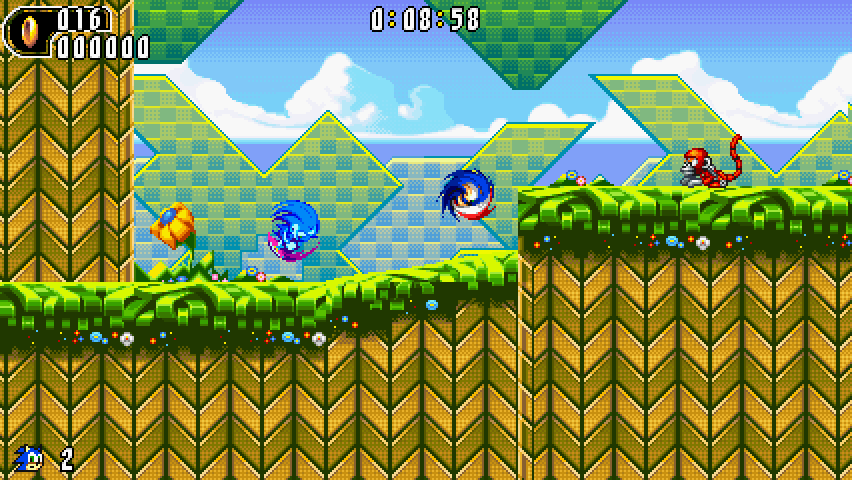
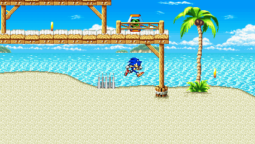
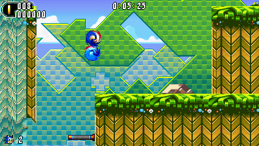
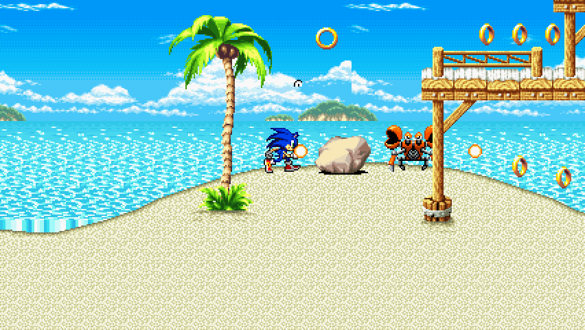
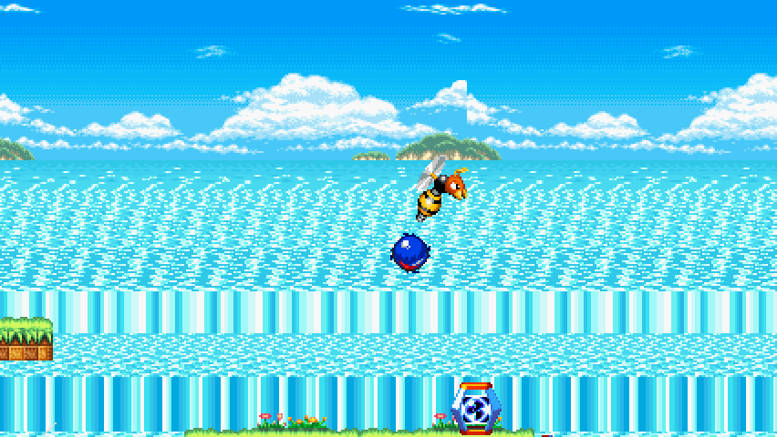
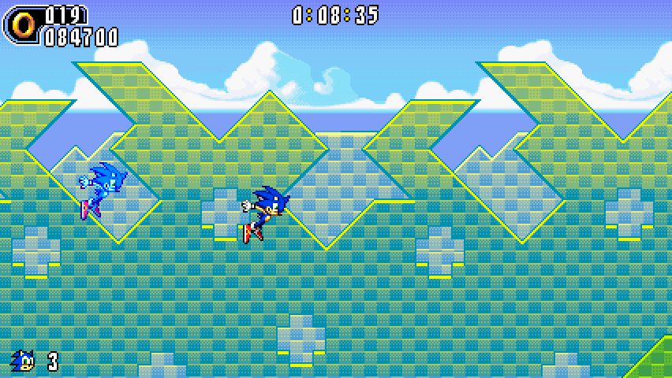
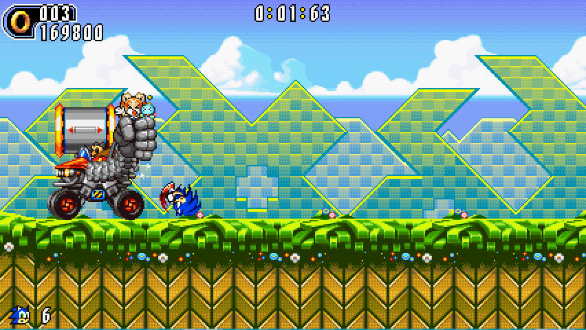
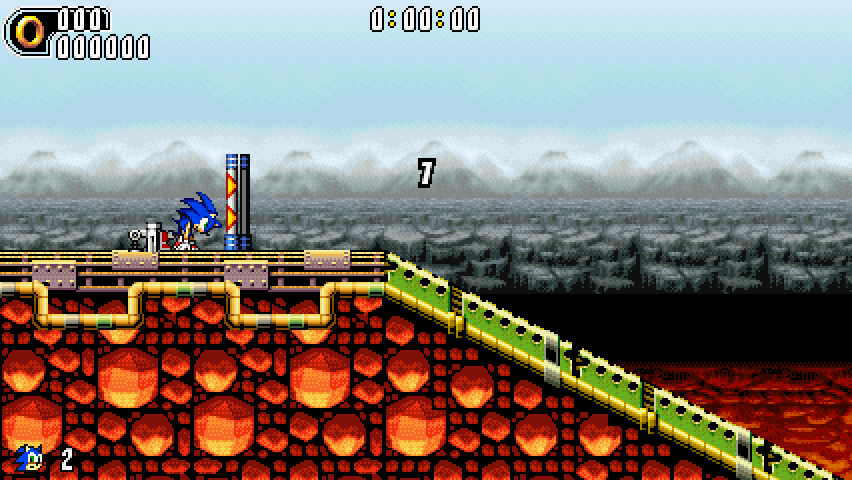

<div align="center">
  <h1>Sonic Advance Remaster</h1>
  <p><strong>Sonic Advance 1 and 2, rebuilt from their own code for the desktop.</strong></p>
  <p>
    A native fan remaster built on the SAT-R decompilation:<br>
    the zones you know, at 426×240, with a new renderer and lighting still to come.
  </p>
  <p>
    
    
    
    
    <a href="LICENSE"></a>
  </p>
  <p>
    <a href="#screens">Screens</a> &nbsp;·&nbsp;
    <a href="#what-this-is">What this is</a> &nbsp;·&nbsp;
    <a href="#status">Status</a> &nbsp;·&nbsp;
    <a href="#what-the-remaster-adds">What the remaster adds</a> &nbsp;·&nbsp;
    <a href="#build-and-capture">Build and capture</a> &nbsp;·&nbsp;
    <a href="#tracking">Tracking</a> &nbsp;·&nbsp;
    <a href="#credits">Credits</a>
  </p>
</div>

<p align="center">
  
</p>

<p align="center">
  <sub>Every picture on this page is a frame captured from a headless run of this project's port. The commands and the frame numbers are in <a href="docs/CAPTURE.md">docs/CAPTURE.md</a>.</sub>
</p>

> [!NOTE]
> Sonic Advance Remaster is an unofficial fan project. It is not affiliated with, endorsed by or connected to Sega. Sonic Advance and Sonic Advance 2, and all in-game art, are the property of Sega. No ROM, BIOS file, save or extracted asset is hosted here.

## Screens

### The ports in motion

<table>
  <tr>
    <td width="50%"></td>
    <td width="50%"></td>
  </tr>
  <tr>
    <td align="center"><sub>Sonic Advance : Neo Green Hill Zone</sub></td>
    <td align="center"><sub>Sonic Advance 2 : Leaf Forest</sub></td>
  </tr>
</table>

### Stills

<table>
  <tr>
    <td width="50%"></td>
    <td width="50%"></td>
  </tr>
  <tr>
    <td align="center"><sub>Neo Green Hill Zone · frame 2100</sub></td>
    <td align="center"><sub>Neo Green Hill Zone · frame 2610</sub></td>
  </tr>
  <tr>
    <td></td>
    <td></td>
  </tr>
  <tr>
    <td align="center"><sub>Leaf Forest Act 2 · frame 3300</sub></td>
    <td align="center"><sub>Leaf Forest boss · frame 5010</sub></td>
  </tr>
</table>

<p align="center">
  
</p>

<p align="center">
  <sub>Hot Crater Act 1 · frame 6900</sub>
</p>

## What this is

Sonic Advance Remaster is a native desktop remaster of Sonic Advance 1 and Sonic Advance 2, built on the [SAT-R decompilation](https://github.com/SAT-R/sa2). The games are not emulated: their decompiled logic is compiled for the desktop, so the presentation can change without changing how they play.

The repository owns the remaster layer: the renderer, the lighting, the build and packaging, and the documentation. Upstream is unlicensed, so it is never vendored here. You clone it outside this repository, supply your own ROMs and build, as described in [Build and capture](#build-and-capture).

What exists today is the foundation, the first real frames, verified windowed runs with audio, and the stage 0 remaster host. The remaster renderer is the next milestone.

## Status

| Milestone | State | What it covers |
| :--- | :--- | :--- |
| **M0 — Project foundation** | Complete | Repository, tracking system, agent instructions, templates and the capture path |
| **M1 — Native ports running** | Complete | Both ports build, run windowed and headless, with keyboard input, audio and a documented capture path |
| **M2 — Renderer and lighting** | In progress | Stage 0 host and software-frame presentation are in the repository; subpixel camera, shader presentation, upscaled assets and 2.5D lighting remain |
| **M3 — Release** | Planned | Packaging and the first public build |

The captures come from the upstream ports as they are today. Sonic Advance's port is the rougher of the two: its menus and some UI render corrupted ([upstream issue #274](https://github.com/SAT-R/sa2/issues/274)) and the HUD is not visible in these frames, so only clean gameplay scenes are shown.

The current ports' measured frame pacing, CPU/GPU cost and input latency are recorded in [docs/PERFORMANCE.md](docs/PERFORMANCE.md). They are measurements of the upstream ports at 426×240, not of the M2 renderer.

## What the remaster adds

The captures already show the first change: the ports render **426×240**, so each zone shows more to the left and right than the GBA's 240×160, and it is captured at that size.

The remaster layer is the M2 work. The stage 0 host and the stage 1 GPU layer path are in the repository: the host presents the upstream software frame through a GL 3.3 core context, and the layer path draws the GBA backgrounds and objects on the GPU from a per-tick snapshot. The visual remaster itself is not implemented yet:

- **Subpixel camera and sprite placement**, so scrolling and movement stay smooth at any resolution.
- **Shader-based presentation and upscaled, hand-checked assets**, keeping the original art direction.
- **2.5D lighting** for sprites and backgrounds, starting with one zone as a vertical slice.

When each of those is captured from a build, it will appear on this page. Until then, this section is a plan, not a claim.

The architecture and the never-vendored build boundary are recorded in [docs/RENDERER.md](docs/RENDERER.md). Stage 0's build driver and host are documented in [tools/stage0/README.md](tools/stage0/README.md), the stage 1 layer path in [tools/stage1/README.md](tools/stage1/README.md), and its verification record in [docs/STAGE1.md](docs/STAGE1.md). The first piece of renderer-owned game state is the BG-sprite composition, documented in [docs/BG-SPRITES.md](docs/BG-SPRITES.md).

## Build and capture

The remaster host still consumes an external upstream checkout; nothing from upstream is vendored here. The upstream port recipe remains:

```sh
git clone https://github.com/SAT-R/sa2 /tmp/sa2
cp "/path/to/Sonic Advance (Europe) (En,Ja,Fr,De,Es).gba" /tmp/sa2/baserom_sa1.gba
cp "/path/to/Sonic Advance 2 (USA) (En,Ja,Fr,De,Es,It).gba" /tmp/sa2/baserom_sa2.gba
cd /tmp/sa2

make -j"$(nproc)" sdl GAME_NAME=sa1
make -j"$(nproc)" sdl GAME_NAME=sa2 TAS_TESTING=1
```

`TAS_TESTING=1` builds the SA2 port with its recorded input tape, which is how the SA2 captures were made without a keyboard; a build without it is what the interactive window check uses. The full recipe, the local capture hook, the environment variables and the frame behind every image are in [docs/CAPTURE.md](docs/CAPTURE.md).

To build the stage 0 host, which keeps the same tape but replaces the upstream SDL presentation with a GL 3.3 core window:

```sh
SA2_UPSTREAM=/tmp/sa2 \
SA2_ROM="/path/to/Sonic Advance 2 (USA) (En,Ja,Fr,De,Es,It).gba" \
SAR_BUILD_ROOT=/tmp/sar-stage0 \
tools/stage0/build.sh

cd /tmp/sar-stage0
SAR_SAVE_PATH=/tmp/sar-stage0/sa2.sav ./sa2-stage0
```

By default this is still software-PPU presentation. `SAR_RENDERER=gl` selects the stage 1 GPU layer path instead, and `SAR_RENDERER=software` selects the software PPU. [tools/stage0/README.md](tools/stage0/README.md) lists the fail-closed checks, the capture helpers and the current limitations, and [tools/stage1/README.md](tools/stage1/README.md) documents the layer path, the switch and the frame comparison.

Upstream is unlicensed and its maintainers do not accept LLM-assisted contributions. It stays outside this repository, and nothing here is proposed back.

## Bring your own ROM

This repository hosts no ROM, BIOS file, save or extracted Sega asset. To build and run the ports you need your own dump of Sonic Advance (Europe) or Sonic Advance 2 (USA); [docs/CAPTURE.md](docs/CAPTURE.md) lists the SHA-1s of the copies used for the captures.

## Tracking

Every change goes through an issue, a branch, a milestone and a pull request, and every PR carries a delivery record of what was checked. The rules are in [CONTRIBUTING.md](CONTRIBUTING.md) and [docs/TRACKING.md](docs/TRACKING.md).

[Issues](https://github.com/NahuelGenchi/sonic-advance-remaster/issues) &nbsp;·&nbsp;
[Milestones](https://github.com/NahuelGenchi/sonic-advance-remaster/milestones) &nbsp;·&nbsp;
[Pull requests](https://github.com/NahuelGenchi/sonic-advance-remaster/pulls)

## Credits

- [SAT-R/sa2](https://github.com/SAT-R/sa2) — the decompilation this remaster builds on. It is unlicensed and is not vendored here.
- Sonic Advance and Sonic Advance 2 were developed by Dimps and Sonic Team and published by Sega. This is an unofficial fan project, not affiliated with or endorsed by Sega.
- The frames and clips were captured from this project's headless runs with the contributor's own ROM copies; [docs/CAPTURE.md](docs/CAPTURE.md) records how.
- Built with SDL2; the capture review tools use Pillow.

## License

The project's own files are licensed under [GPL-3.0-or-later](LICENSE). Upstream `SAT-R/sa2` has no license and is never vendored into this repository, so nothing from it is distributed here. ROMs and Sega assets are not included.
