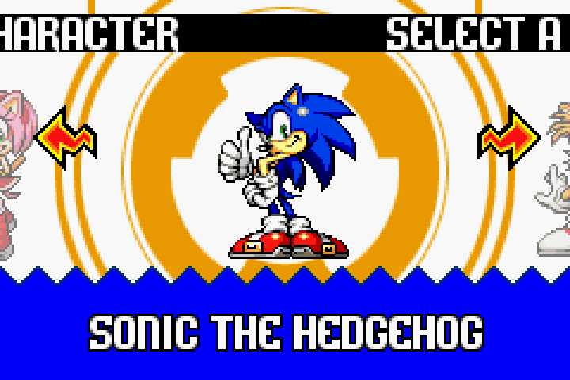
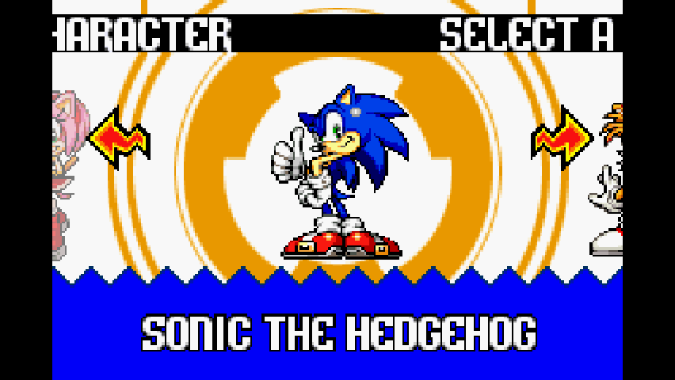

# BG-sprite composition

[Back to README](../README.md) · [Renderer](RENDERER.md) · [SA1 UI](SA1-UI.md) ·
[Frame capture](CAPTURE.md) · [Stage 0 host](../tools/stage0/README.md) ·
[Issue #16](https://github.com/NahuelGenchi/sonic-advance-remaster/issues/16)

**Status:** the module in `remaster/renderer/` is implemented and recorded
against the Sonic Advance 1 character select. The staff credits screen and
the other BG-sprite screens are not captured yet; see the limitations at the
end of this document.

## What a BG sprite is

A "BG sprite" is a full-screen image that the game uploads as character data
and then displays through a text background. Sonic Advance's character select
is one: animation 723 is 600 tiles (a 240x160 picture in 4bpp) uploaded to
`BG_CHAR_ADDR_FROM_BGCNT(1) + 0x40`, and the sprite is registered every frame
with `DisplaySprite_BG` on background layer 1 (`gBgCntRegs[1] = 0x1907`).

The picture only reaches the screen through the layer's tilemap: every
8x8 tile of the image needs an entry in the 32x32 map of layer 1. The game
never writes that map on the portable build, because the two upstream
functions that do it are disabled there:

| Upstream | Role | Portable state |
| :--- | :--- | :--- |
| `sub_80039E4` (`src/background.c:865`) | per-frame BG-sprite compositor | stubbed: clears `gBgSpritesCount` and returns |
| `sub_8004010` (`src/background.c:1058`) | text-BG map fill from `gBgSprites_Unknown1/2` | incomplete decompilation; the relevant fill branch is `#if 0` |

`remaster/renderer/bg_sprites.c` is the project-owned equivalent of both. It
derives every map entry from the registered sprite (its subframe layout,
position, flips, palette and character base). It never hardcodes a tile
number or a map address.

## The files

| File | Contents |
| :--- | :--- |
| `remaster/renderer/bg_sprites.h` | The composition API: frame snapshot, map geometry, statistics. No upstream includes. |
| `remaster/renderer/bg_sprites.c` | The compositor and the map fill. No upstream includes, so it can be tested on its own. |
| `remaster/renderer/bg_sprites_port.h` | The adapter API used by a host. |
| `remaster/renderer/bg_sprites_port.c` | The adapter: reads the upstream globals and hands a snapshot to the compositor. The only file that includes upstream headers. |
| `remaster/renderer/tests/bg_sprites_test.c` | Synthetic tests for the map geometry, the fills, the composition, the flips, the palettes and the stale entries. |
| `remaster/renderer/README.md` | How to build and run the module and its tests. |

## VBlank order

The module has to run between the game tick and the software PPU draw. The
order is fixed by what each step needs:

```text
1. the game tick writes VRAM, queues the character data of the registered
   BG sprites and sets the fill state
2. SarBgSpritesBeginVBlank()   snapshot the BG-sprite state
3. the VBlank interrupt runs   the queued character data is copied into VRAM
                                and upstream clears the fill state
4. SarBgSpritesCompose()       write the tilemap entries
5. gpsp_draw_frame()           the software PPU draws the frame
```

Step 2 is before step 3 because upstream's VBlank handlers clear the state
the module reads (`gBgSpritesCount` and `gBgSprites_Unknown2`). Step 4 is
after step 3 because the map has to be written after the character data it
references, and before step 5 because the frame has to show the composed map.

`remaster/host/main.c` implements that order in `VBlankIntrWait`. The
Sonic Advance 1 evidence in this repository was recorded with the M1 capture
path (`docs/CAPTURE.md`), whose local hook calls the same two functions in
the same place.

## Map geometry

The compositor reads the layer's geometry from `BGCNT` and `DISPCNT`:

| Property | Rule |
| :--- | :--- |
| Character base | `(BGCNT & 0x0C) << 12`; the tile number of a sprite's character data is its distance from that base, shifted by 5 (4bpp) or 6 (8bpp). |
| Map base | `(BGCNT & 0x3F00) >> 8` blocks of 2 KB, the same mask the portable build uses. |
| Text map size | `BGCNT >> 14`: 32x32, 64x32, 32x64 or 64x64 tiles. The row stride is the map width in tiles, so a 64-wide map addresses its second block correctly and a 32x64 map keeps its 32-tile rows. |
| Affine map size | `BGCNT >> 14`: 16, 32, 64 or 128 tiles square. |
| Text or affine | `DISPCNT` mode 0: all layers are text. Mode 1: layer 2 is affine. Mode 2: layer 3 is affine. |
| Map entry | bits 0-9 tile, bit 10 X flip, bit 11 Y flip, bits 12-15 palette. A text map entry has no priority field; the layer priority stays in `BGCNT` and the module never writes a register. The OAM priority of a subframe is dropped, as upstream does (`attr2 & 0xF3FF`). |

## Ownership rules

A background layer can be written by the game, by the compositor, or by
neither. The rules keep the two from stepping on each other:

1. **A layer with a BG sprite belongs to the compositor.** Its map is cleared
   and rewritten every frame, so no entry of an earlier screen and no entry
   of an earlier position of the sprite survives in it.
2. **A layer without a BG sprite belongs to the game.** Its map is left
   alone. A screen can unregister its sprite for a frame without giving the
   layer away, so the last composition stays, like on the hardware.
3. **The game takes a layer over by writing its map.** When it does, the
   entries the compositor still owns are stale and are released. The release
   only clears entries that still hold the value the compositor wrote, so a
   map the game has taken over is never touched.
4. **The fills the game requests are applied** (`sub_8004010`): a rectangle
   of map entries is filled with one tile number. The end column and the end
   row are exclusive, and an end column of `0xFF` means "to the end of the
   row". Every rectangle the two games request fits that reading, including
   the full 32x32 map (`{0, 0, 0xFF, 32}`) and the 20-row clear of the
   character select (`{0, 0, 0xFF, 0x20}`).

## What the composition does with a sprite

For every subframe of a registered sprite the compositor writes the map
entries of that subframe:

- the sprite's anchor is `sprite->x - dimensions->offsetX` (and the same for
  Y), aligned down to a 16x8 pixel grid;
- a flipped sprite is mirrored around its far edge and every written entry
  gets the matching flip bit, so the picture is mirrored and not reordered;
- the tile numbers of a subframe increase in reading order, and the palette
  of the subframe plus the sprite's palette bank selects the map entry's
  palette;
- entries outside the map are dropped.

## Verification

### Source checks

```sh
cc -std=c11 -Wall -Wextra -Werror -I remaster/renderer \
   remaster/renderer/bg_sprites.c remaster/renderer/tests/bg_sprites_test.c \
   -o /tmp/bg_sprites_test && /tmp/bg_sprites_test
```

```text
bg_sprites_test: all checks passed
```

The tests cover the map geometry of the four text map sizes and the four
affine map sizes, the map base, the fills (full map, partial rectangle, empty
rectangle), the composition of several sprites on layers with different map
sizes, the X and Y flips, the palette bits, a sprite that moves, and the
release of the entries the game has taken over.

### Port checks

The Sonic Advance 1 evidence was recorded with the M1 capture path on
2026-10-20, from a disposable snapshot of the pinned upstream tree
(`393357f7c9d46b5c10b6c41a57b80fe3b58f3c8d`) with the capture hook of
`docs/CAPTURE.md`, the two calls of this module, and the module linked into
the port. The upstream checkout was not modified.

Native 240x160 build:

```sh
HEADLESS=true \
  CAPTURE_DIR=$CAPTURE_DIR CAPTURE_SCRIPT=sa1 CAPTURE_EVERY=10 CAPTURE_MAX=1600 \
  timeout 300 ./sa1.sdl
```

Frame 1000 is the character select. It shows the authored backdrop, the
orange emblem of animation 723, with no stale tilemap:



Compare with the frames of `docs/SA1-UI.md`: the "before" frame shows the
tilemap of the previous screen, and the "after" frame is the local stand-in
that fills the map with tile 2. Neither of them shows the emblem: the
stand-in replaces the whole map with one tile, so the picture of the
animation is lost.

426x240 build, with the local UI viewport prototype and the local GBA OAM
diagnostic of `docs/SA1-UI.md` (neither of them is in this branch):

```sh
SA1_UI_VIEWPORT=1 HEADLESS=true \
  CAPTURE_DIR=$CAPTURE_DIR CAPTURE_SCRIPT=sa1 CAPTURE_EVERY=10 CAPTURE_MAX=1600 \
  timeout 300 ./sa1.sdl
```



Sonic Advance 2, stage 0 host, tape frame 1200, unchanged:

```sh
SA2_UPSTREAM=/tmp/opencode/upstream/sa2 SAR_BUILD_ROOT=$BUILD_ROOT tools/stage0/build.sh
SDL_VIDEODRIVER=x11 SDL_AUDIODRIVER=dummy SAR_VSYNC=0 \
  SAR_CAPTURE_DIR=$CAPTURE_DIR SAR_CAPTURE_FRAME=1200 SAR_EXIT_AFTER_FRAME=1200 \
  SAR_SAVE_PATH=$SAVE ./sa2-stage0
```

```text
134e4df9b462e85f0e7a1a54727beec0c449454a5706d5f64a5f9c7692a81110  frame_001200.ppm
134e4df9b462e85f0e7a1a54727beec0c449454a5706d5f64a5f9c7692a81110  frame_001200.gl.ppm
```

Both hashes are the ones recorded for the stage 0 host before this change.

## Limitations

- **Sonic Advance 1 has no stage 0 host yet.** The evidence above comes from
  the M1 capture path, with a local, uncommitted call site for the module.
  The stage 0 host carries the same call, but only Sonic Advance 2 is built
  by `tools/stage0/build.sh` today.
- **The staff credits screen is not captured.** It uses the same layer setup
  (`gBgCntRegs[1] = 0x1907`) and the same fill state
  (`gBgSprites_Unknown1[1] = 1`, `{0, 0, 0xFF, 0x14}`), so the fill path is
  covered by the synthetic tests, but no recorded frame of that screen
  exists. Reaching the credits needs a finished game.
- **The other BG-sprite screens are not captured.** Sonic Advance 2 uses
  `DisplaySprite_BG` in two bosses and in the special stage; those runs were
  not recorded here.
- **Affine BG sprites are not composed.** The upstream affine branch of
  `sub_80039E4` is unfinished upstream, and no screen in scope uses it. The
  compositor counts such a sprite as skipped instead of writing a guessed
  map.
- **A cleared map entry points at tile 0**, whose character data belongs to
  the game. The character select's backdrop covers the whole 240x160 field,
  so nothing stale is visible there, but a 426x240 frame still shows the
  unowned rows of the map, which is the map-bounds problem of #15.
- **The 426x240 frame still needs the UI viewport and the OAM layout fix**
  (#15 and #14) for the rest of the screen. The frame above shows both
  local research prototypes, not this branch.
